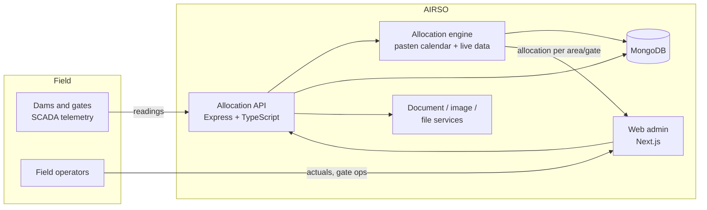

# AIRSO: Irrigation Water Allocation Platform

**Client:** a provincial water resources authority in Indonesia (name withheld)
**Role:** Lead Software Engineer, Digibay (architecture, backend, allocation engine, delivery)
**Timeline:** 3 months, after a previous 6-month implementation by another vendor stalled

## The problem

The authority manages **14 dams and 493 water-gate points** that feed irrigated farmland. Water has to be shared fairly between areas, and the right amount changes constantly: it depends on what each area is planting, which growth stage the crop is in, and how much water is actually available in the dams.

Farmers plan around their own planting calendar (*pasten*), which sets when each area plants and what each crop stage needs. Operators were combining that calendar with dam and gate readings largely by hand. The previous attempt to digitise this had produced a system that displayed data but did not calculate allocations, and the project had stalled.

## What I built

The obvious brief was a dashboard for water distribution. The real value was the **calculation**: an engine that works out how much water each area should receive.

- **Allocation engine** that encodes the *pasten* calendar (planting schedule and crop-stage water needs per area) and combines it with **live SCADA readings** from dams and gates (27 real-time telemetry streams).
- Allocations are **dynamic**, reacting to real water conditions, while staying **consistent with the agreed calendar and rules**, so operators can trust and explain the numbers.
- **Field workflows** for 10 operators: recording actuals, gate operations, and reports.
- Supporting services for documents, images, and file management.

## Key decisions

- **Model the domain first.** I sat with operators to understand how *pasten* actually drives allocation, then modelled calendar, crop stage, area, and gate as first-class entities before writing UI.
- **Separate the engine from the API.** Allocation logic lives in its own module with clear inputs (calendar state + live readings) and outputs (allocation per area/gate), so it can be tested on its own and adjusted as rules change.
- **Reuse a hardened service template.** API, auth (JWT), validation (Joi), logging (Winston), and Docker/PM2 setup came from Digibay's internal backend template, so the team spent its time on the domain rather than boilerplate.
- **Small services for heavy I/O.** Documents, images, and file uploads run as separate services so they do not slow down allocation requests.

## Results

- Delivered in **3 months** after the previous **6-month** attempt stalled.
- Covers **14 dams, 493 water-gate points, 27 real-time telemetry streams**.
- Operators get allocation figures that reflect both the farmers' schedule and real water levels, instead of a dashboard that only shows readings.

## Stack

TypeScript · Node.js / Express · MongoDB (Mongoose) · Next.js · JWT / Passport · Joi · Winston · Docker · PM2

<!-- TODO (Adnan): add 1–2 redacted screenshots (allocation view, gate map) and, if you can share it, a simplified description of the allocation formula inputs. -->
