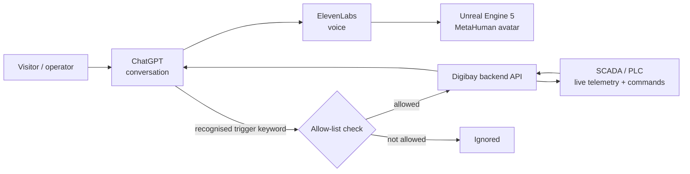

# AIVA: A Conversational Virtual Human Connected to Live Infrastructure

**Context:** Digibay product, first shown at World Water Forum 2024 (Bali)
**Role:** Lead Software Engineer (concept, conversation and voice integration, Unreal Engine, backend, SCADA integration)

## The problem

For World Water Forum 2024 we wanted visitors to talk to water infrastructure: ask what a dam is doing, and have the answer come from live data. Later, operators wanted the same assistant to trigger commands, not just answer questions. That changes the risk completely: a talking character must never move a gate because it misheard or misunderstood.

## What I built

AIVA is a conversational virtual human rendered with **Unreal Engine 5 and MetaHuman**. I built the conversation pipeline and everything that connects it to the real world.

- **Conversation and voice:** visitor questions go to **ChatGPT (OpenAI API)** for the answer, and **ElevenLabs** turns the answer into a natural voice for the avatar.
- **Unreal Engine 5 and MetaHuman avatar** that speaks the answer in real time, delivered in **three days** for World Water Forum 2024.
- **Backend API integration** so the avatar can read live SCADA telemetry from dams and gates and answer with real values.
- **Command triggering with an allow-list:** operational commands are only triggered when the conversation matches a defined set of validated trigger keywords, each mapped to a specific API call. Anything outside the allow-list is ignored.
- Shown again at **GITEX Asia 2025**, and productised into a reusable virtual human platform, adapted as the **Diponegoro Digital Avatar** for the National Gallery of Indonesia.
- The same work became my undergraduate thesis: a holographic AI virtual assistant based on ChatGPT, using Unreal Engine 5 and MetaHuman.

## Key decisions

- **Use proven services for language and voice, own the integration.** ChatGPT and ElevenLabs handled language and voice so we could ship in three days; my effort went into the avatar and the parts that touch real infrastructure.
- **Allow-list, not free-form commands.** Commands can only be triggered by a small, explicit set of validated keywords mapped to specific API calls, so the avatar cannot invent an action.
- **Keep equipment behind our API.** The avatar never talks to SCADA directly; every read and command goes through our backend, where it can be logged and controlled.

## Results

- Built in **3 days** for World Water Forum 2024; shown again at GITEX Asia 2025.
- Reused for the National Gallery of Indonesia.
- As Digibay's flagship demo, it helped secure a conference main-sponsor partnership worth **over IDR 500M (about USD 30K)**.

## Stack

ChatGPT (OpenAI API) · ElevenLabs · Unreal Engine 5 · MetaHuman · Node.js / TypeScript backend API · SCADA integration
