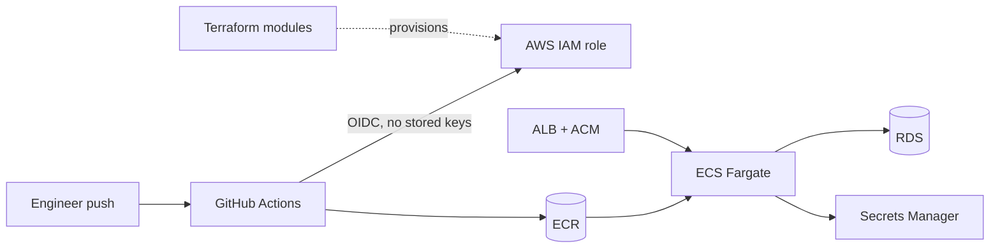

# Platform and Infrastructure at Digibay

**Role:** Founder and Lead Software Engineer (design and operation)

## The problem

A small team delivering many client systems needs every project to be deployed the same safe way, without hand-built servers or long-lived cloud keys, and without a dedicated ops team.

## What I built

### AWS foundation as code

Modular **Terraform** with one module per concern:

| Module | Purpose |
|---|---|
| `network` | Multi-AZ VPC, subnets, routing |
| `ecr` | Container registries |
| `ecs` | ECS Fargate services |
| `ec2` | Instances where Fargate does not fit |
| `alb` / `acm` | Load balancing and TLS certificates |
| `rds` | Managed PostgreSQL |
| `iam` | Least-privilege roles |
| `secrets` | AWS Secrets Manager |

- Remote state bootstrapped separately (`bootstrap/state`) and environments composed from modules (`environments/prod`).
- **Keyless deploys:** GitHub Actions authenticates to AWS through **OIDC**, so no long-lived access keys are stored in CI.
- **Cost-aware, phased rollout:** expensive resources are only created when a product actually needs them.

### On-premises estate

- Ran **71 containerized services across 15 virtual machines** on Proxmox: applications, databases, object storage, messaging, and auth.
- Monitored with **Zabbix and Grafana**, reaching **99.97% uptime** over a 12-month period. Most of these services have since been wound down.

### Shared engineering foundations

- Internal templates for backend (Express/TypeScript, NestJS file service) and frontend (React + Mantine), shared across projects through git subtrees/submodules, so security and logging fixes reach every service.
- Standard Docker, CI, linting, and test setup in every service.

## Results

- One repeatable, auditable deployment path for every project.
- No long-lived cloud credentials in CI.
- **99.97% uptime** across 71 services over a 12-month period, run by a team of up to four engineers.

## Stack

Terraform · AWS (VPC, ECR, ECS Fargate, EC2, ALB, ACM, RDS, IAM, Secrets Manager, S3) · GitHub Actions (OIDC) · Docker · Proxmox · Zabbix · Grafana · Linux
