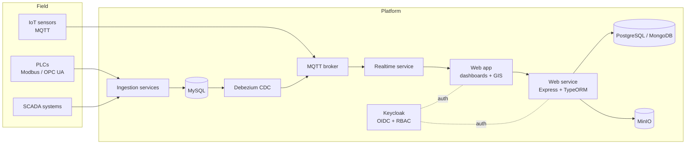

# Utility Telemetry Platform

**Client:** a regional water utility in Indonesia (name withheld)
**Role:** Lead Software Engineer, Digibay (architecture, integration, on-site installation)

## The problem

The utility runs **127 infrastructure assets across 4 branches**. Data lived in separate SCADA systems, PLCs, and standalone sensors, each speaking a different protocol. Managers had no single view, and each branch needed to see only its own assets.

## What I built

A platform that ingests telemetry from every source, stores it, and serves dashboards, GIS views, and APIs to each branch.

- **Ingestion** every 15 minutes from SCADA, PLCs, and IoT sensors over **Modbus, OPC UA, and MQTT**, about **365,000 readings per month**.
- **Event-driven pipeline:** PLC data lands in MySQL; **Debezium CDC** streams changes to MQTT and live dashboards, so new consumers can subscribe without touching the producers.
- **Access control** with **Keycloak (OIDC) and RBAC**: operators, managers, and administrators in each branch see only the assets and actions they are permitted.
- **GIS views** of assets and a real-time service for live values.
- I **installed and calibrated field sensors on site**, so I owned the data path from device to database to dashboard.

## Key decisions

- **CDC instead of polling.** Streaming database changes through Debezium decoupled the PLC writers from every downstream consumer and removed custom sync jobs.
- **Protocol adapters at the edge.** Each protocol has its own adapter, so adding a new device type does not touch the core.
- **Centralised identity.** Keycloak gives every app in the platform the same login and the same branch-level permissions.
- **Shared service template.** Backend services share a common core (dependency injection with tsyringe, TypeORM, validation, logging, CI via GitHub Actions) distributed through git subtrees/submodules, so fixes land in every service.

## Results

- One view of **127 assets across 4 branches**, about **365,000 readings per month**.
- Branch-level access control for operators, managers, and administrators.
- Part of the estate monitored with Zabbix and Grafana at **99.97% uptime** over 12 months (see [Platform and infrastructure](platform-infrastructure.md)).

## Stack

TypeScript · Node.js / Express · TypeORM · PostgreSQL · MySQL · MongoDB · MinIO · Keycloak · Debezium · MQTT · Modbus · OPC UA · Docker · GitHub Actions

<!-- TODO (Adnan): add a redacted dashboard or GIS screenshot. -->
